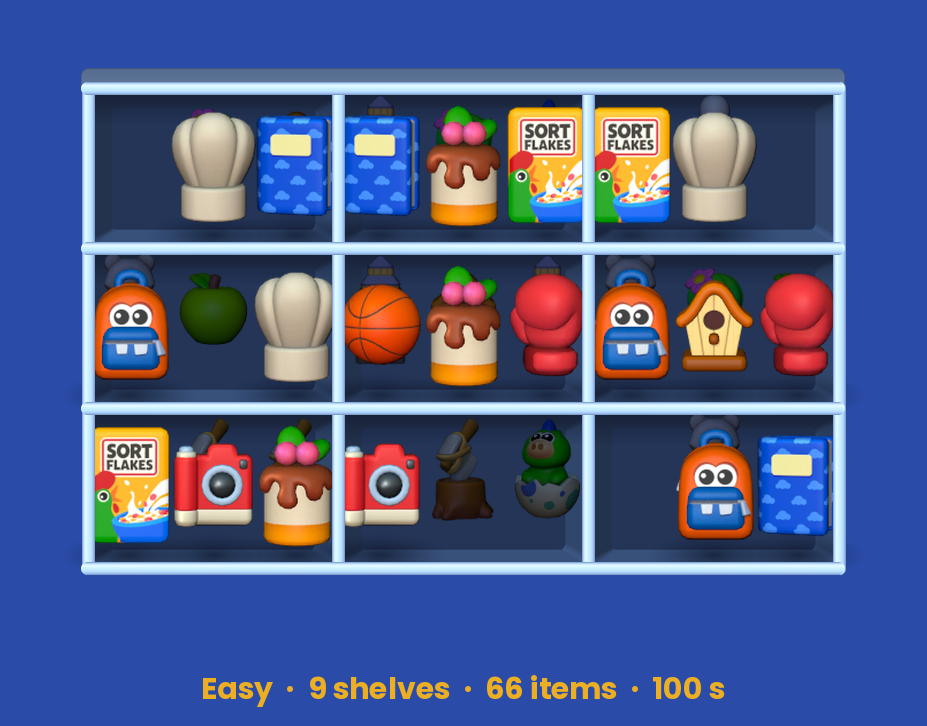
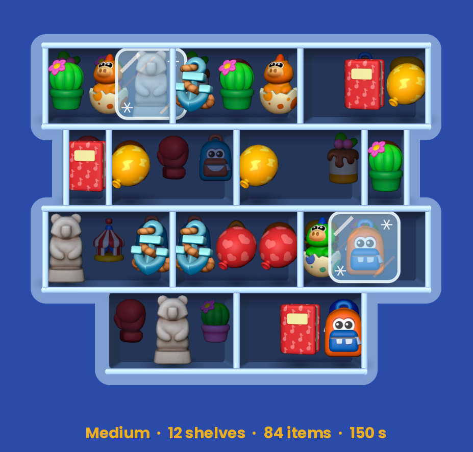
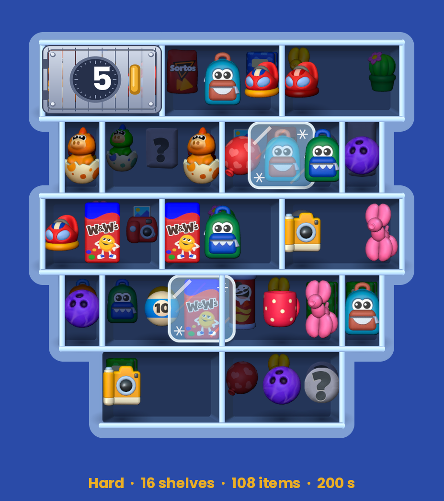
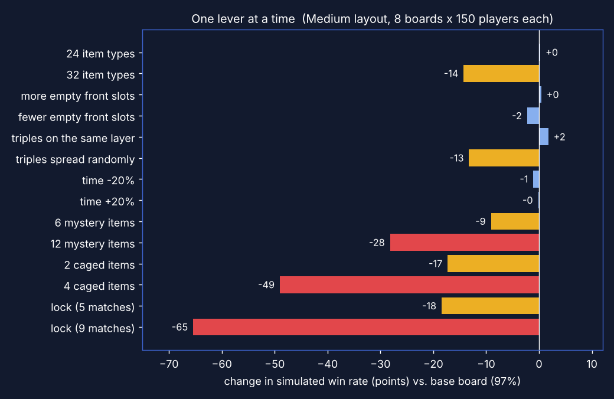

# Sort Express: Kolay / Orta / Zor Level Tasarımı

**▶ Oyna (WebGL, telefonda ve masaüstünde açılır):** https://zeydusht.github.io/sort-express-level-design/

> Case sorusu: *"Oyunumuz için kolay, orta ve zor levelları nasıl yapardın?"*

**Kısa cevap:** Zorluğu sezgiyle kurmam. Önce oyunun kendi level verisinden hangi kolların (lever) kullanıldığını çıkarırım. Sonra her leveli bu kollarla kurar, bir çözücü ve simüle edilmiş bir oyuncu kitlesiyle ölçerim. Level ancak hedef kazanma oranı bandına oturunca çıkar. Bu repo bu sürecin çalışan hali: Unity'de oynanabilir 3 level ve onları üreten, ölçen araçlar.

| | **Easy** | **Medium** | **Hard** |
|---|---|---|---|
| Sort Express'teki karşılığı | Normal (`ld 0`) | Hard (`ld 10`) | Super Hard (`ld 20`) |
| Raf / ön slot / katman | 9 / 27 / 3 | 12 (2 tekli) / 32 / 4 | 16 (4 tekli) / 40 / 4 |
| Item / tür | 66 / 22 | 84 / 28 | 108 / 36 |
| Renk varyantlı (benzer) tür | 0 | 16 | 34 |
| Ön sırada boş slot | 6 / 27 | 10 / 32 | 13 / 37 |
| Engel | yok | 2 Frozen item (**yeni mekanik**) | 5 eşleşmelik kilit + 6 Mystery item + 2 Frozen |
| Süre | 100 sn (1,52 sn/item) | 150 sn (1,79 sn/item) | 200 sn (1,85 sn/item) |
| Çözülebilir mi? (çözücü) | ✔ 43 hamle | ✔ 71 hamle | ✔ 87 hamle |
| **Simüle kazanma oranı** (1000 oyuncu) | **%95** | **%61** | **%35** |
| Hedef bant | %88–100 | %50–75 | %20–45 |
| Kaybın ana nedeni | hamle kalmaması (%5) | süre (%31) | süre (%39) + hamle kalmaması (%26) |

| Easy | Medium | Hard |
|---|---|---|
|  |  |  |

---

## 1. Önce veri: Sort Express'in 2150 leveli

Kaynak, APK içindeki level dosyaları (`TextAsset/Level00001_0.json … Level02150_0.json`). Analizi `Tools/analyze_levels.py` (zorluk döngüsü, mekaniklerin ilk görüldüğü level) ve `Tools/tier_stats.py` (tier tier tahta anatomisi) yapıyor. Format çözümlemesi (`ld` zorluk, `tl` süre, `s` raflar, `sicw` slot sayısı, `si` katmanlar, `lmc` kilit, `pr.ib` frozen, `pr.imy` mystery, `isdp` cargo door, `icl` shutter, `ig` item üretici) bölüm 6'da.

### 1a. Zorluk bir rampa değil, bir ritim

15. levelden itibaren **5 ile biten her level Hard (`ld 10`)**, 20. levelden itibaren **0 ile biten her level Super Hard (`ld 20`)**. Bu kuralın istisnası yok (213 / 214 level). Yani her 10 levelde **8 normal + 1 hard + 1 super hard** var: testere dişi bir eğri. Zor level bir ödül/gerilim anı. Arkasından hep rahatlatan normal levellar geliyor.

### 1b. Yeni mekanik hiçbir zaman zorluk zirvesinde gelmiyor

| Mekanik (oyundaki adı) | Veri anahtarı | İlk level | | Mekanik | Veri anahtarı | İlk level |
|---|---|---|---|---|---|---|
| Lock | `lmc` | 4 | | Mystery Item | `imy` | 61 |
| Item Generator | `it -1` + `ig` | 4 | | Wide Shelf | `sicw > 3` | 71 |
| Single Shelf | `sicw 1` | 8 | | Rotating Door | `if` | 81 |
| Moving Shelf | `im` | 11 | | Piñata | `it 5` | 91 |
| **Frozen Item** | `ib` | **21** | | Fuse Box | `fbi` | 131 |
| Cargo Door | `isdp` | 31 | | Dragon Egg | `it 7` | 141 |
| Shutter | `icl` | 41 | | Iris | `irs` | 211 |

Mekanik adları ve açıklamaları Yağız Gür'ün blocker tablosundan (AppMagic verisi), ilk görüldükleri level ise level dosyalarından. İki kaynak birebir tutuyor. Fuse Box, Dragon Egg ve Iris adları oyunun kendi sınıf adlarından (`FuseBoxShelf`, `DragonEgg…`, `IrisShelf`). Hepsi prototipte oynanabilir (bölüm 6).

Yeni mekaniklerin çoğu **1 ile biten** bir levelde geliyor: super hard'ın hemen ardından gelen normal bir levelde. Oyuncu yeni kuralı baskı altında değil, rahat bir levelde öğreniyor. Zorluk zirvesiyle aynı levele düşmüyor.

### 1c. Zor levellar daha *fazla* süre veriyor

| Level 1–100 (medyan) | Süre | Item | Tür | Raf | sn/item | Kilitli level | Frozen'lı level |
|---|---|---|---|---|---|---|---|
| Normal | 175 | 99 | 33 | 10 | 1,56 | %15 | %12 |
| Hard | 180 | 108 | 36 | 14 | **1,62** | %56 | %22 |
| Super Hard | 200 | 132 | 44 | 14 | **1,67** | %33 | %33 |

| Level 101–300 (medyan) | Süre | Item | Tür | Raf | sn/item | Kilitli level | Frozen'lı level |
|---|---|---|---|---|---|---|---|
| Normal | 120 | 123 | 40 | 12 | 1,02 | %14 | %21 |
| Hard | 175 | 135 | 42 | 15 | **1,24** | %55 | %35 |
| Super Hard | 185 | 146 | 47 | 15 | **1,27** | %10 | %20 |

Item = eşleştirilecek her şey (yerleştirilmiş itemler, generator'ın dağıttıkları, piñatalar ve içleri). Generator'daki boş slotlar item sayılmıyor.

**Çıkarım:** Zor tier'larda item başına süre *artıyor*, azalmıyor. Zorluk süre baskısından değil, tahtanın kendisinden geliyor: daha çok tür, daha çok raf, daha çok engel. Süre ise oyun ilerledikçe genel olarak sıkılaşan bir ayar (300'lük bantlarda medyan 1,21 → 1,03 → 0,90 → 0,97 → 1,04 → 0,88 → 0,78 → 0,69 sn/item).

### 1d. Super Hard'ın anatomisi (2150 levelin hepsi)

Medyan, parantez içinde levellerin ortadaki yarısı (25.–75. yüzdelik). `Tools/tier_stats.py`, ham sonuçlar `Tools/results/tier_stats.json`.

| | Normal | Hard | Super Hard |
|---|---|---|---|
| Level sayısı | 1722 | 214 | 214 |
| Raf | 13 (12–15) | 15 (14–17) | **16 (15–17)** |
| Tekli raf | 0 | 2 | 2 (levellerin %55'inde) |
| Ön slot | 39 | 42 | 45 |
| Item | 126 (111–138) | 141 (129–150) | **153 (144–168)** |
| Tür | 41 (36–45) | 45 (40–50) | **50 (47–54)** |
| Ön slot başına item (derinlik) | 3,27 | 3,36 | **3,54** |
| Boş slot payı | %18 | %16 | %16 |
| Süre | 115 sn (90–145) | 150 sn (120–175) | **170 sn (140–215)** |
| sn/item | 0,92 | 1,02 | **1,11** |
| Engel türü sayısı | 2 (1–3) | **3 (2–3)** | 2 (1–3) |
| Hiç engeli olmayan | %18 | %9 | %13 |
| Renk ikizi olan tür | 16 | 14 | 12 |

Engeller: levellerin yüzde kaçında var, kullanıldığında medyan kaç tane.

| Engel | Normal | Hard | Super Hard |
|---|---|---|---|
| Shutter | %20 · 3 raf | %40 · 4 raf | **%34 · 4 raf** |
| Cargo Door | %24 · 2 raf | %35 · 2 raf | %27 · 2 raf |
| Lock | %18 · 2 raf, ~10 eşleşme | %38 · 2 raf, ~9 eşleşme | %23 · 2 raf, ~10 eşleşme |
| Frozen Item | %21 · 3 item | %31 · 5 item | %21 · 5 item |
| Piñata | %13 · 6 | %11 · 6 | %21 · 6 |
| Moving Shelf | %20 · 5 raf | %14 · 5 raf | %19 · 10 raf |
| Rotating Door | %8 · 2 raf | %13 · 2 raf | %18 · 2 raf |
| Wide Shelf | %20 · 2 | %12 · 2 | %16 · 2 |
| Mystery Item | %14 · 4 | %10 · 5 | %13 · 5 |
| Fuse Box | %9 · 2 kutu, 6 hedef | %10 | %7 |
| Dragon Egg | %7 · 18 | %25 · 18 | %2 |
| Iris | %5 | %11 | hiç yok |

**Çıkarımlar**
- **Hard engel ağırlıklı, Super Hard tahta ağırlıklı.** Hard'da medyan 3 engel türü var (kilit, shutter, cargo door, frozen, yumurta). Super Hard'da engel türü sayısı Normal ile aynı (2), fark tahtada: en çok raf, item ve tür, en derin raflar.
- Her super hard'ı bir önceki (normal) levelle karşılaştırınca: medyan **+20 item, +8 tür, +1 raf, +38 sn süre**, engel türü sayısı aynı (214 çift).
- Süre zorlaştırmak için kullanılmıyor: super hard item başına daha fazla süre veriyor (1,11 sn, Normal'de 0,92).
- Iris super hard'da hiç yok, yumurta neredeyse hiç yok (%2). Hard'da sık olan bu mekanikler zirve levelde kullanılmıyor.
- En sık super hard kurguları: engelsiz (%13), tek başına frozen, moving ya da piñata, lock + cargo door + rotating door, shutter + rotating door, lock + shutter + piñata.
- Case'deki Hard leveli oyunun **ilk 100 levelindeki** super hard'lara göre ayarlı: renk ikizi ağır (orada 44 türün 40'ı ikizli) ve üç engel türü. Sonraki bantlarda super hard tahta ağırlıklı hale geliyor. Bölüm 6'daki boş sayfa tarifi bu güncel hali hedefliyor.

Item, tür, süre, raf ve engel sayıları level dosyalarından birebir. Derinlik ve boş slot payı, generator'ın satırları nasıl dağıttığına dair varsayıma bağlı (bölüm 6).

## 2. Zorluk kolları: hangisi ne kadar etkili?

Tahta sabitken her seferinde tek bir kolu değiştirip simülasyonla ölçtüm (Medium yerleşimi, engelsiz; 8 farklı tahta × 150 simüle oyuncu; `Tools/sensitivity.py`).

- **Süre tek başına neredeyse etkisiz** (±%20 süre, ±1 puan). Bu, veride gördüğümüzle aynı. Süre, tahta zorlaştığında devreye giren bir **çarpan**: engelli tahtalarda kayıpların çoğu süre bitiminden geliyor.
- **Engeller en güçlü ve en doğrusal olmayan kollar.** 5 eşleşmelik kilit −18 puan, 9 eşleşmelik kilit −65 puan. 2 frozen item −17, 4 frozen item −49. Küçük bir sayı değişikliği leveli "zor"dan "imkânsız"a atabiliyor. Bu kollar level bazında ince ayar istiyor.
- **Engeller birbirini katlıyor:** ayrı bir denemede (6 tahta × 120 oyuncu) engelsiz %93 olan tahtada kilit tek başına %69, frozen tek başına %74, ikisi birlikte **%38** verdi. Veride görülen "her seferinde tek yeni mekanik" kuralının sayısal karşılığı bu.
- **Item çeşitliliği ve dağılım orta etkili:** 28 → 32 tür −14 puan, üçlülerin rastgele dağılması −13 puan.
- **Ön sıradaki boşluk** bu aralıkta zayıf bir kol. Asıl etkisi "hamle kalmadı" kayıplarında görülüyor.

## 3. Üç level

### Easy: öğret, akış, kazan (Normal tier)
- **Hedef:** Oyuncu kuralı (3 aynı item yan yana patlar, ön sıra boşalınca arkadaki öne gelir) hatasız öğrenmeli ve kazanmalı. Hedef %88+.
- 9 raf, 3 katman, **22 tamamen farklı görünen item** (renk varyantı yok, karıştırma riski sıfır).
- Üçlülerin %75'i aynı katmanda. Açılışta bir itemin (aşçı şapkası) üç kopyası da ekranda, yani ilk patlama 3 hamlede yapılabiliyor ve kural ilk saniyelerde öğreniliyor.
- Ön sıra %78 dolu, arka katmanlar %82–85. Tahta küçük ve türler az olduğu için fazla boşluğa gerek yok.
- Engel yok. Süre cömert (1,52 sn/item); simülasyonda kazananlar ortalama 32 sn'de bitiriyor.
- **Sonuç: %95 kazanma.** Kayıpların neredeyse tamamı "hamle kalmadı": rafları rastgele doldurup kendini kilitleyen oyuncular.

### Medium: tek yeni mekanik (Hard tier)
- **Hedef:** Oyuncuyu düşündürmek ama yıldırmamak. Hedef %50–75.
- Verideki kurala uygun olarak **tek yeni mekanik: Frozen item** (buz içinde, yerinden oynamaz, diğer ikisi onun yanına getirilir). Eşleri bilerek ulaşılabilir yerde, ama oyuncunun önce o raftaki diğer itemleri boşaltması gerekiyor. Mini bir planlama bulmacası.
- 2 tekli raf (her katmanda tek item). Bunlar hem park yeri hem de kazılması gereken bir yığın.
- Ön sıra daha boş (%68 doluluk, Easy'de %78). Bu benim tercihim: gerçek oyunda boş slot payı tier'lar arasında %16–18 civarında, ama tahtalar daha derin ve itemler sıralar içinde kümeleniyor. Bizim 3–4 katmanlı tahtamızda engel ve tür artarken oyuncuya manevra alanı bırakılmazsa level "hamle kalmadı" ile bitiyor.
- **Algısal zorluk:** 16 türün renk ikizi var (kırmızı/mavi kamera, turuncu/mavi çanta…). Hızlı bakışta karıştırılıyor.
- Üçlüler daha dağınık (aynı katman %60, komşu katman %30).
- Süre 1,79 sn/item. Veride olduğu gibi Easy'den *daha fazla* sn/item.
- Kilit bilerek yok: simülasyonda kilit + frozen birlikte kazanmayı %38'e düşürüyordu (bant altı). Kilit Hard'a kaldı.
- **Sonuç: %61 kazanma** (süre 2,5 katı olsa %78; kayıpların çoğu süre).

### Hard: kombinasyon ve bilgi kısıtı (Super Hard tier)
- **Hedef:** Gerçek bir "boss level": iyi oyuncu kazanır, ortalama oyuncu 2–3 denemede. Hedef %20–45.
- 16 raf (4 tekli), 108 item, 36 tür, bunların **34'ünün renk ikizi var** (3 renkli kamera, 3 renkli balon…).
- **5 eşleşmelik kilit** sol üstte: oyuncuya erken bir ara hedef verir ve tahtanın bir köşesini başlangıçta kapatır.
- **6 Mystery item** ilk iki katmanda: oyundaki gibi taş heykel olarak duruyorlar (itemin dış hatları + "?"), rengini ancak raflarında ya da yanlarında eşleşme yapınca görürsün. Planlamayı bilgi eksikliği ile zorlaştırıyor.
- 2 Frozen item: Medium'da öğretilen mekanik burada tekrar ediyor.
- Ön sıra en boş tahta (%66 doluluk). Süre en yüksek (200 sn) ve sn/item yine artıyor (1,85).
- **Sonuç: %35 kazanma.** Kayıpların bir kısmı "hamle kalmadı" (%26). Burada tahta doluyor, oyuncunun sırayı düşünmesi gerekiyor.

### Editörle tasarladığım levellar
Level Editor'de kaydedilen her level oyunun menüsünde **MY LEVELS** altında oynanabiliyor. Aşağıdaki tablo yayınlama sırasında (Sortex → 3. Publish to GitHub) her level 1000 simüle oyuncuyla oynatılarak otomatik yazılıyor; kazanılamayan (3'ün katı olmayan) levellar yayınlanmıyor.

<!-- MY-LEVELS:START -->
_Bu tablo **Sortex → 3. Publish to GitHub** ile otomatik güncelleniyor (son: 2026-10-11 13:10)._

| Level | Tier | Raf | Item | Tür | Süre | Engeller | Simüle kazanma (1000 oyuncu) | Hedef bant | Kayıp: süre / hamle kalmadı | Çözücü |
|---|---|---|---|---|---|---|---|---|---|---|
| Level 1 | Normal | 11 | 24 | 8 | 100 sn (4,17 sn/item) | shutter 1, cargo door 1, moving 5, geniş raf 1, frozen 1, mystery 1 | **%82** | %88–100 (daha zor) | %18 / %0 | ✔ 18 hamle |
<!-- MY-LEVELS:END -->

## 4. Doğrulama: çözücü + simüle oyuncu

- **Aynı kural kodu:** Unity oyunu ile simülatör aynı `Board.cs` dosyasını kullanıyor (`Assets/Sortex/Scripts/Core`). Ölçtüğüm oyun ile oynanan oyun aynı.
- **Çözülebilirlik:** tam bilgili oyuncu ile denemeler, olmazsa derinlik öncelikli arama (DFS). Üç level de kanıtlı çözülebilir.
- **Oyuncu modeli** (`Assets/Sortex/Scripts/Core/Simulator.cs`, editör ve komut satırı aynı kodu kullanıyor):
  - Oyundaki gibi ön sırayı ve hemen arkasındaki sırayı görür. Mystery itemi bilmez, Cargo Door'un arkasını göremez.
  - Üçlü tamamlar, temiz çift kurar, çifti bozmaktan kaçınır, aynı itemi tekrar tekrar oynatmaz.
  - Takıldığında, arka sırasında görünen çiftlerin üçüncüsü olan rafı kazar.
  - Beceri 0,35–0,9 arasında dağılıyor ve karar gürültüsünü (softmax sıcaklığı) belirliyor.
  - Hamle süresi = 0,40 sn + 0,015 sn × ekrandaki tür sayısı (+0,5 sn iyi hamle yoksa), beceriyle ölçekleniyor.
- **Seçim:** Her zorluk için aynı tarifle 24 aday tahta üretildi. Hepsi 300 oyuncuyla oynatıldı, bandın ortasına en yakın olan seçildi. Seçilenler 1000 oyuncuyla yeniden ölçüldü (tablodaki sayılar).
- **Booster yok:** Simüle oyuncular booster, revive ya da Final Duo seri ödülü kullanmıyor. Gerçek oyunda bunlar kazanma oranını yükseltir, bu yüzden bantlar "saf tahta zorluğu" olarak okunmalı.
- **Sınır:** Model gerçek oyuncu değil. Mutlak oranlar değil, **sıralama ve kolların göreli etkisi** güvenilir kısım. Bir sonraki adım gerçek playtest ile kalibrasyon: ilk denemede kazanma, level başına deneme sayısı, kazanma süresi dağılımı, başarısızlık sonrası çıkış oranı.

## 5. Canlıda nasıl yönetirdim

- **Ölçüm (level başına):** ilk denemede kazanma oranı, ortalama deneme, booster kullanımı, level sonrası çıkış (churn). Bant dışına çıkan level işaretlenir.
- **Ayar sırası:** Veri gösteriyor ki zorluk tahtadan geliyor. Önce tahta kolları (tür sayısı, üçlü dağılımı, engel sayısı), en son süre. Engel sayıları küçük adımlarla değiştirilir (kilit 9 → 5 bir leveli tamamen değiştiriyor).
- **Kayıp tipi = monetizasyon anı:** Simülasyondaki iki kayıp tipi oyunun iki fail offer'ıyla birebir eşleşiyor. Süre bitince Revive #1 (+60 sn), yer kalmayınca Revive #2 (karıştırma). Hard'da kayıpların %39'u süre, %26'sı yer kaynaklı, yani iki teklif de devreye giriyor. Easy'de neredeyse hiç fail offer anı yok, olması gereken de bu. Bir levelin kayıp karışımını değiştirmek (örneğin daha az ön boşluk = daha çok "yer kalmadı"), hangi teklifin gösterileceğini de değiştirir.
- **Ritim:** 8-1-1 testere dişi korunur. Yeni mekanik süper zor levelden hemen sonra, rahat bir levelde öğretilir, sonraki hard/super hard'da diğer kollarla birleştirilir (Medium → Hard'daki Frozen gibi).
- **A/B:** Aynı tarifle üretilen farklı tohumlar (seed) varyant olarak test edilebilir. Simülasyon hangi varyantların banda düştüğünü önceden süzer.

## 6. Teknik detaylar

### Çalıştırma (Unity 6000.6.4f1, URP 2D, Input System)
1. Projeyi Unity Hub ile aç. İlk açılışta `Sortex` menüsü sahneyi (`Assets/Scenes/SortexGame.unity`), sprite materyalini ve WebGL ayarlarını kendisi kuruyor (elle: **Sortex → 1. Setup Project**).
2. **Play** ile test et. Oyun, Sort Express'in kendi ana menüsüyle açılıyor: yeşil **Level N** butonu sıradaki leveli oynatır (Easy → Medium → Hard → editörle kaydedilenler; kazandıkça ilerler), alttaki **Packs** sekmesi tüm levelları listeler. Sürükle-bırak (fare/dokunmatik) veya önce iteme, sonra hedef rafa dokun. Sağ üstteki pause butonu oyunun pause penceresini açar (**Continue** devam, **Quit** ana menü).
3. **Sortex → 2. Build WebGL (docs)** komutu oyunu `docs/` klasörüne derler (gzip + tarayıcıda açma desteği, GitHub Pages'ta header ayarı gerektirmez). GitHub Pages bu klasörü yayınlıyor (*Settings → Pages → Deploy from a branch → `main` / `/docs`*).
4. **Sortex → 3. Publish to GitHub** (Level Editor'de **⬆ Publish**) tek adımda her şeyi yapıyor: kaydedilen levelları 1000 simüle oyuncuyla oynatıp README'deki tabloyu ve menü kartlarını günceller, WebGL'i derler, commit edip GitHub'a gönderir. Site 1–2 dakika içinde güncellenir. İlk gönderimde GitHub girişi için bir pencere açılır. Adımlar `Logs/SortexPublish.log` dosyasına yazılır.

### Ana menü (oyunun kendisinden)
Açılış ekranı, oyunun `MainScene.prefab` dosyasından birebir kuruluyor (`Tools/make_main_menu.py` → `Resources/Sortex/Menu`, çizen kod `Scripts/Game/MainMenuView.cs`):
- HomePage'in arka planı (`MainSceneBackground`), yeşil `LoadLevelButton`, üst bar (avatar, can, coin) ve alt `NavigationBar` (Shop · Leaderboard · Home · Packs · Settings).
- Her objenin konumu, ölçeği, `SpriteRenderer` ayarları (9-slice boyutu, flip, renk, sıralama) ve `SortingGroup`'ları prefab'daki değerlerle aynı; sprite'lar oyunun UI atlasından kesiliyor. Yazılar oyunun fontu **Bango Pro** ile, TextMeshPro materyallerindeki yüz / kontur renkleriyle çiziliyor.
- Hard levelda buton oyundaki gibi kırmızı "Hard Level", Super Hard'da mor "Super Hard" oluyor (`PlayButtonHardLevel`, `PlayButtonSuperHardLevel`).
- Ekran genişliği oyundaki gibi 4,6166 birim (menü sayfaları bu aralıkla dizili); üst bar üst kenara, buton ve alt bar alt kenara göre yerleşiyor.
- Prefab'daki MonoBehaviour'lar export'ta boş geldiği için yazıların içeriği (Level N, Full, 1000) ve etkinlik (LiveOps) şeritleri koddan geliyor; etkinlik ikonları yok.

### Level ekranı (oyunun kendisinden)
- **Ölçek:** Level dosyaları 3 slotlu rafları 3,13, satırları 1 birim aralıkla koyuyor; oyun yatay ekseni yarı ölçekte çiziyor (3 slotlu raf ekranda ≈ 1,6 × 1). Bu oran oyunun ekran görüntüsünden ölçüldü (satır aralığı / raf aralığı) ve `BoardView.XS = 0.5` ile uygulanıyor. Model ve simülasyon level dosyasındaki sayılarla çalışmaya devam ediyor; yalnızca çizim sıkışıyor. Raf sprite'ları oyunun `BaseShelf.prefab` modelinden bu oranla yeniden üretildi (`Tools/render_shelf.py`).
- **Kamera:** Oyundaki gibi en az 4,6166 birim genişliği gösteriyor ve raflar üst bar ile booster'lar arasına sığana kadar uzaklaşıyor. Raflar ekranın genişliğini ince bir payla dolduruyor.
- **Üst bar ve booster'lar:** `LevelSceneUI.prefab`'dan (`Resources/Sortex/Level/level.json`, `Scripts/Game/LevelHud.cs`): tier'a göre lacivert / kırmızı / mor "Level N" plakası, yeşil çerçeveli süre (son 10 saniyede kırmızı, uyarı ışığı yanıp söner) ve pause butonu. Alttaki dört booster (vakum, sihirli şapka, boya tabancası, dondurucu) oyunda 3D model; burada oyunun ikonlarıyla duruyor ve prototipin parçası değil (dokununca bilgi verir). Sürenin yeşil halkası (oyunda shader) ve booster rafı (oyunda 3D) sprite olarak yeniden çizildi.
- **Pause penceresi:** `LevelPauseDialog.prefab`'dan (`Resources/Sortex/Level/pause.json`, `Scripts/Game/PauseDialog.cs`): "Paused" şeridi, müzik / ses / titreşim / ipucu düğmeleri, **Continue** ve **Quit**. Pause açıkken süre durur.
- Üç ekranı da (`menu`, `level`, `pause`) aynı kod kuruyor: `Scripts/Game/PrefabScreen.cs`.

### Level Editor (Unity içinde)
**Sortex → Level Editor** (Ctrl+Shift+L) ile açılıyor. Leveller oyunun kendi JSON formatında kaydediliyor.

- **Dolap:** `+ 3-Shelf`, `+ Single`, `+ Wide` araçlarıyla tıklayarak raf eklenir. Raflar gerçek oyundaki konum ızgarasına oturur (yarım slot × 0,25 satır). Select aracıyla sürüklenir, Del ile silinir.
- **Moving row:** `+ Moving row` level 11'deki gibi 5 rafı tek sıra halinde ekler. Ekranda ortadaki 3 raf görünür, dıştakiler borunun içinde bekler. Sıra yana kayar, bir kenardan boruya girip öbür kenardan çıkar. Yön ve hız sağ panelden ayarlanır (oyunda çoğunlukla 1 birim/sn).
- **Raf ayarları:** sıra sayısı (row sekmelerinin yanındaki `+ Row` / `− Row`), Lock (kaç eşleşmede açılır), Shutter, Cargo Door, Moving, Rotating Door, Iris (*Starts closed* ile kapalı başlar), Fuse Box (paletten seçili itemi `+` ile hedef olarak ekler, en fazla 3), slot sayısı (tekli / 3 / geniş).
- **Itemler:** paletten seçilip (projedeki tüm `item_*.png`) slota boyanır. Sıralar arasında 1–9 tuşlarıyla geçilir, Shift+tık bir rafın sırasını tümden doldurur. Frozen ve Mystery araçları itemi işaretler. **Piñata** aracı seçilen renkte bir piñata koyar, içine paletteki itemi yerleştirir (köşedeki küçük ikon). **Egg** aracı ejderha yumurtası koyar. Paletteki kırmızı sayaç 3'ün katı olmayan türleri gösterir (piñata renkleri ve içlerindeki itemler dahil).
- **Kontroller:** 3'ün katı kuralı, ulaşılamayan frozen item, boş shutter, açılamayacak kilit, tahtada olmayan fuse box hedefi, üst üste binen raf. Sol panelde tahta sayıları, gerçek oyunun aynı tier medyanlarıyla yan yana.
- **Auto-fill:** rafları sen çizersin, itemleri tarif yerleştirir (tür sayısı, ön/arka doluluk, üçlülerin dağılımı, renk ikizi oranı, frozen/mystery sayısı). Normal / Hard / Super Hard hazır ayarları case levellarının tarifleri. **Fill & tune** birkaç tohum dener, her birini simüle eder ve tier bandının ortasına en yakın olanı bırakır.
- **Simulate:** aynı çözücü ve simüle oyuncular editörün içinde, arka planda çalışır. Sonuçta kazanma oranı, bant kontrolü, kayıp tipleri ve ortalama süre görünür.
- **▶ Play level:** leveli doğrudan Play modunda açar. Kaydetmek gerekmez. Game sekmesi otomatik olarak 1080×1920 dikey telefon ekranına geçer.
- **Save:** yeni level `Level 1`, `Level 2`… adıyla `Resources/Sortex/Levels` içine kaydedilir. Oyunun menüsünde **MY LEVELS** başlığı altında sırayla listelenir.
- **⬆ Publish:** kaydedilen levelları simüle eder, README'deki "Editörle tasarladığım levellar" tablosunu yazar, WebGL'i derler ve GitHub'a gönderir (bölüm 6, Çalıştırma 4).
- **Kayıtlı leveli açmak:** `Open ▾` menüsü kayıtlı levelleri listeler. Project penceresinde bir level `.json` dosyasına sağ tıklayıp **Open in Sortex Level Editor** de olur (çift tıklamak dosyayı metin olarak açar). Açtıktan sonra `▶ Play level`.
- **Oyunun orijinal levelleri:** `Open ▾ → From file…` ile APK'dan çıkan `Level00091_0.json` gibi bir dosya seçilir ve `▶ Play level` ile oynanır. Item generator'lı levellerde üretilen slotlar editörde **G** olarak görünür, itemler level başlarken dağıtılır. `Save As…` ile `Levels` klasörüne kaydedilen level MY LEVELS'a da girer.

### Boş sayfadan Super Hard (editörde)
Sol panel artık her satırda gerçek oyunun bu tier için medyanını, altında da 25.–75. yüzdelik aralığını ve en sık kullanılan engelleri gösteriyor.

1. **New**, sonra **Tier: Super Hard**.
2. **Dolap:** 16 raf (12 tane 3'lü + 4 tekli, case'deki Hard gibi), her rafa 5 sıra. Bu ~40 ön slot ve Auto-fill ile ~144 item / 48 tür eder: gerçek super hard aralığının içinde.
3. **Engel:** 1–2 tür yeter. Oyunda en sık olanlar shutter (4 raf) ve cargo door (2 raf). Kilit kullanacaksan küçük tut (aşağıdaki tablo). Iris ve yumurta super hard'da kullanılmıyor.
4. **Auto-fill → Super Hard.** Güncel oyuna benzesin istersen *Colour twins* ≈ 0,25 (oyunun ilk 100 levelinde ≈ 0,9). Frozen ya da mystery istemiyorsan 0 yap.
5. **Süre:** ~1,4 sn/item ile başla (144 item → 200 sn). Oyunun medyanı 1,11 sn ama simüle oyuncu gerçek oyuncudan yavaş.
6. **Fill & tune** (en az 12 tohum) %20–45 bandını hedefler. **Simulate** (1000 oyuncu) ile doğrula, **▶ Play level** ile oyna, **Save** ile MY LEVELS'a ekle.

Bu tarifi simülatörde denedim (8 tohum, 200 oyuncu, 1,4 sn/item, ~144–156 item):

| Engel seti | Kazanma oranı (8 tohum) | %20–45 bandındaki tohum |
|---|---|---|
| Engelsiz, sadece tahta | %2–67 | 2 / 8 |
| Shutter × 4 | %4–63 | 3 / 8 |
| Shutter × 4 + Cargo Door × 2 | %3–62 | 3 / 8 |
| Kilit 3 + 3 eşleşme | %0–46 | 0 / 8 |
| Kilit 3 + 3 + Rotating Door × 2 | %0–53 | 0 / 8 |

- Aynı tarif ve aynı engellerle kazanma oranı tohuma göre %2'den %67'ye oynuyor. Super hard'ı asıl belirleyen, itemlerin rafa nasıl dağıldığı. Bu yüzden tek tohum yerine Fill & tune.
- Bu ölçekte kayıpların çoğu "hamle kalmadı". Kilit en sert kol: kilitli raflar dolu başladığı için tahtadaki boş yer azalıyor.

### Prototipteki mekanikler
Kurallar tek bir dosyada (`Assets/Sortex/Scripts/Core/Board.cs`). Oyun, editör ve simülatör aynı kodu kullanıyor. Oyunun koduna erişimim yok: kurallar level verisinden, oyunun tutorial görsellerinden ve sınıf adlarından çıkarıldı. *Varsayım* yazanları canlı oyunda doğrulamak gerekiyor.

| Mekanik | Prototipte |
|---|---|
| Lock (`lmc`) | Raf, tahtada N eşleşme yapılana kadar kapalı. Kilidin üstündeki sayaç her eşleşmede azalır. |
| Item Generator (`it -1`, `ig`) | Gruptaki (`gid`) rafların **G** slotlarını, sonra arkalarına yeni sıraları dalga dalga (`isg`) doldurur. Her slot için tür, dalganın ağırlıklarıyla çekilir: `slw` aynı sırada olan bir tür, `blw` öndeki sırada olan bir tür, `rw` herhangi bir tür; `ssp` ağırlıkların kullanılma olasılığı. Hazır üçlü oluşturmaz, fuse box'a kendi hedefini koymaz. *Varsayım: ağırlıkların anlamı.* |
| Single / Wide Shelf (`sicw`) | Tekli raf sadece park yeri ve yığın. Geniş rafta **yan yana** üç aynı item patlar, item raf içinde kaydırılabilir. *Varsayım: tutorial görselinden.* |
| Moving Shelf (`im`) | Sıra yana kayar, borulardan girip çıkar. Sadece ekrandaki raflar kullanılabilir. |
| Frozen Item (`ib`) | Yerinden oynamaz. Diğer ikisi yanına getirilir, eşleşince buz kırılır. |
| Cargo Door (`isdp`) | Ön sıranın arkası görünmez. |
| Shutter (`icl`) | Raf boşalınca kalıcı olarak kapanır. |
| Mystery Item (`imy`) | Taş heykel. Rafında ya da komşu rafta eşleşme olunca açılır. |
| Rotating Door (`if`) | Kapının her yüzü bir sıra. Ön sıra temizlenince kapı döner, sıradaki yüz gelir. Lambalar kalan yüzleri gösterir, arka yüzler görünmez. *Varsayım: oyunda `FerrisShelf`.* |
| Piñata (`it 5`) | Aynı renkten (`pci`, 6 renk) üç piñata yan yana patlar, içindeki item (`pcii`) aynı slota düşer ve yeni bir üçlü kurabilir. |
| Fuse Box (`fbi`) | Raf, listedeki itemlerin her biri tahtada bir kez eşleşene kadar kapalı. Her hedef eşleşince bir pencere yanar, hepsi yanınca kutu açılır. |
| Dragon Egg (`it 7`) | Item gibi sıralanır, üç yumurta yan yana gelince çatlar. |
| Iris (`irs`) | Her hamleden sonra açılıp kapanır. Kapalıyken item alınmaz, konmaz. `irs 1` kapalı başlar. *Varsayım: açılıp kapanma ritmi.* |

Orijinal levellerin simülasyonu (60 oyuncu, booster yok): L4, 6, 11, 31, 81, 91, 131 %100; L61 %95; L114, 211 %97; L144 %73; L141 %38; L300 (super hard) %0. Bu, varsayımların oyunu bozmadığını ama L141 ve L300 gibi levellarda modelin gerçek oyuncudan daha zorlandığını gösteriyor.

### Araçlar (`Tools/`)
| Dosya | Ne yapar |
|---|---|
| `analyze_levels.py` | Zorluk döngüsü ve mekaniklerin ilk görüldüğü level (bölüm 1a–1b) |
| `tier_stats.py`, `stats/BoardStats.cs` | Tier tier tahta anatomisi: raf, item, tür, süre, derinlik, boşluk, her engel (bölüm 1c–1d). `BoardStats.cs` levelleri generator dağıttıktan sonraki haliyle ölçer. |
| `leveldesign.py` | Kollardan level üretir, simülatörle ölçer, banda en yakın tohumu seçer |
| `sim/Sim.cs` | Komut satırından simülasyon. Çözücü ve oyuncu modeli `Assets/Sortex/Scripts/Core/Simulator.cs` içinde, editörle ortak (`mcs -optimize+ -out:Tools/sim/sim.exe Assets/Sortex/Scripts/Core/*.cs Tools/sim/Sim.cs`) |
| `sensitivity.py`, `plot_levers.py` | Kol duyarlılık çalışması ve grafiği |
| `render_level.py` | Level JSON'ını oyundaki görünümüyle PNG'ye çizer |
| `make_main_menu.py`, `unity_yaml.py` | Oyunun prefab'larından ekranları çıkarır (düğüm ağacı, sprite'lar, yazı stilleri) ve bir önizleme PNG'si çizer: `--screen=menu` (`MainScene.prefab`), `--screen=level` (`LevelSceneUI.prefab`), `--screen=pause` (`LevelPauseDialog.prefab`). GUID → dosya eşlemesi için Unity'de **Sortex → Tools → Index Asset Export** |
| `make_sprites.py`, `meshrender.py` | Raf, kilit, buz, shutter ve cargo door sprite'ları. Kilit kapısı APK'daki `obstacle_lock_main_*` mesh'lerinden. |
| `make_obstacles.py` | Piñata, yumurta, döner kapı, iris ve fuse box sprite'ları (oyunun tutorial görsellerinden kesilip temizlenir) |
| `render_shelf.py`, `prefab_dump.py` | Oyunun kendi `BaseShelf.prefab` modelinden raf sprite'ları (slot = level aralığının yarısı) |
| `tests/CoreTests.cs` | Kural kodu için regresyon testleri (JSON gidiş-dönüş, shutter, frozen, kilit, raf içi kaydırma, hareketli raf, piñata, fuse box, iris, döner kapı, yumurta, geniş raf, item generator, auto-fill) |
| `results/` | Simülasyon raporları (`report.json`, `sensitivity.json`) ve tier analizi (`tier_stats.json`) |

### Level formatı
Leveller Sort Express'in kendi JSON formatında (`Assets/Sortex/Resources/Sortex/Levels`). Oyunun orijinal level dosyaları da aynı okuyucu ile yüklenebiliyor. Kullanılan anahtarlar:

| Anahtar | Anlam |
|---|---|
| `ld` | zorluk etiketi: 0 normal, 10 hard, 20 super hard |
| `tl` | süre (sn) |
| `s[].pos` | raf merkezi (dünya birimi; 3'lü raf 3,13 birim genişlikte) |
| `s[].sicw` | slot sayısı: 1 tekli, 3 normal, 4+ geniş |
| `s[].si[].rd[]` | katmanlar (ön katman ilk) ve slotlar: `it 1` item, `0` boş, `-1` generator doldurur, `5` piñata, `7` ejderha yumurtası |
| `s[].lmc` | kilit: raf N eşleşme yapılana kadar kapalı |
| `s[].isdp` | cargo door: ön sıranın arkasındaki sıralar gizli |
| `s[].icl` | shutter: raf boşalınca kalıcı olarak kapanır |
| `s[].im`, `mv`, `ms` | hareketli raf: aynı yükseklikteki `im` rafları birlikte kayar. `mv.x` yön (ilk levellerde doğrudan hız), `ms` hız (birim/sn). Ekran 3 raf genişliğinde, gerisi kenarlardaki boruların içinde (`MovingShelves1xPipeHorizontal.prefab`) |
| `s[].if` | döner kapı: her sıra kapının bir yüzü |
| `s[].irs` | iris: 0 açık, 1 kapalı başlar |
| `s[].fbi` | fuse box: rafı açmak için eşleşmesi gereken item id'leri |
| `s[].gid`, `ig[].isg[]` | item generator grubu ve dalgaları: `icd[]` (`id2` item, `ic` adet), ağırlıklar `ssp`, `slw`, `blw`, `rw` |
| `rd[].pr.pci` / `pr.pcii` | piñata rengi (0–5) ve içindeki item |
| `rd[].pr.ib` / `pr.imy` | frozen (yerinden oynamaz) / mystery item: taş heykel. Oyun itemin dış zarfı mesh'ini (`item_*_hull`) taş dokusu (`MysteryItemTexture`) ve "?" (`MysteryItemQuestionMark`) ile çiziyor, açılınca taş parçalanıyor (`MysteryItemParticle`). Prototip zarfı ikonun dış hattından hesaplıyor. |

---

*Not: Item görselleri, arka plan ve level formatı Circle Games'in Sort Express oyunundan (APK) alınmıştır ve yalnızca bu case çalışması için kullanılmıştır. Font: Poppins (SIL Open Font License).*
